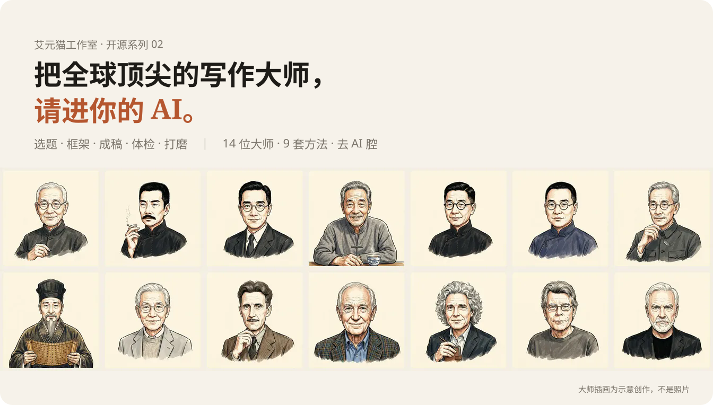
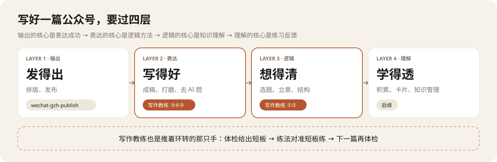
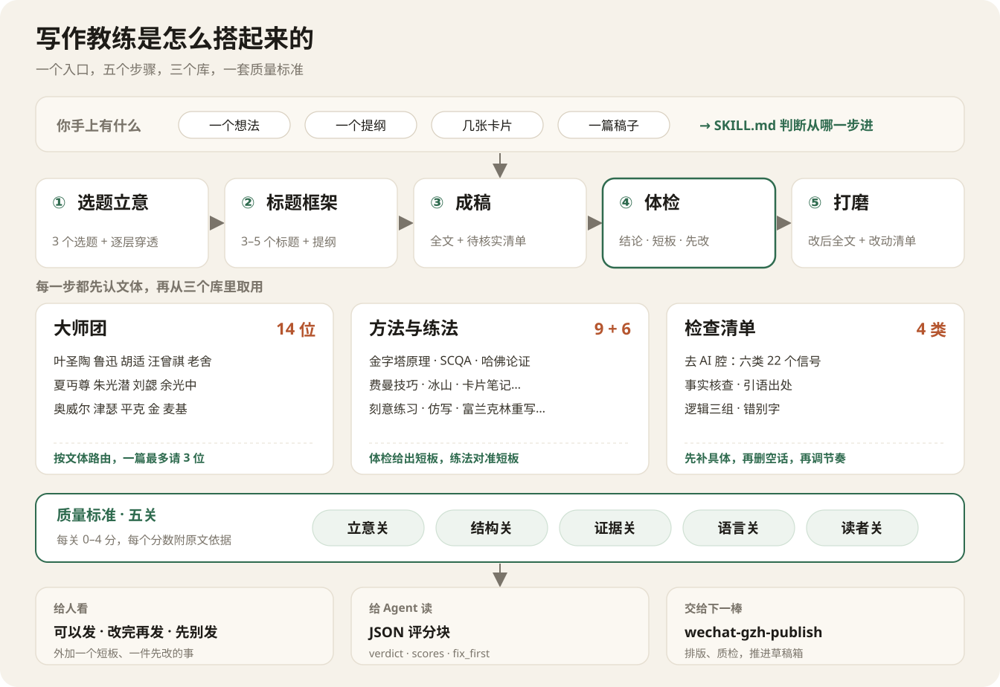
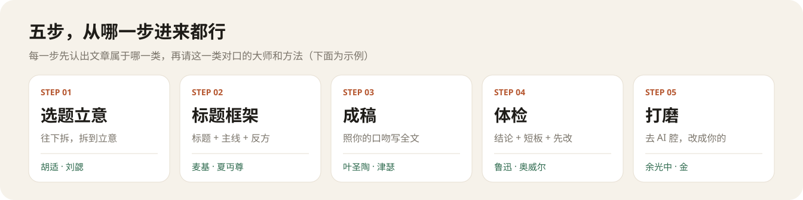
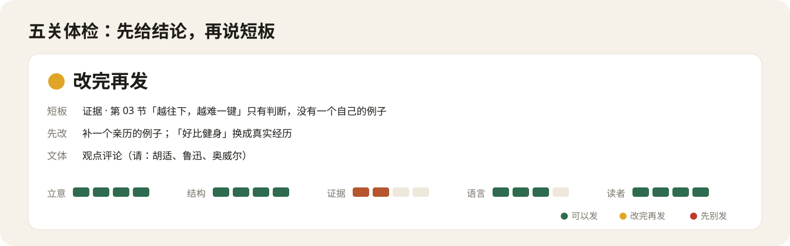

<div align="center">



**[展示页](https://laomao-ai.github.io/writing-coach-skill/)** · **[大师展厅](https://laomao-ai.github.io/writing-coach-skill/masters.html)** · **[完整样例](examples/walkthrough.md)** · MIT

</div>

## 它管写作的哪一段



排版发布交给同系列的 [wechat-gzh-publish](https://github.com/laomao-ai/wechat-gzh-publish)。写作教练管中间两层：把文章想清楚、写好，再用体检告诉你短板在哪，下一篇就练那一处。

## 它是怎么搭起来的



## 五步，从哪一步进来都行



每一步先认出文章属于哪一类，再请这一类对口的大师和方法：写观点请胡适、鲁迅，写随笔请汪曾祺、朱光潜，写教程请津瑟、叶圣陶。14 位大师、9 套方法，每条主张都写明出处，请的是方法，不模仿口吻。

> 写完后至少看两遍，竭力将可有可无的字，句，段删去，毫不可惜。
> ——鲁迅《答北斗杂志社问》

每张大师卡开头收一两句金句，逐字对过原文；体检时大师点评也会引上一句。

## 体检：能不能发，一眼看懂



立意、结构、证据、语言、读者，五关过一遍，只告诉你三件事：**能不能发、短板在哪、先改什么**。语言关单列一项**去 AI 腔**：六类信号，先补具体，再删空话，最后调节奏，改回你自己的口吻。要接进别的 Agent，体检末尾附 JSON 评分块。

## 安装

```bash
git clone https://github.com/laomao-ai/writing-coach-skill ~/.claude/skills/writing-coach
```

支持 Agent Skills 的工具都能用（Claude Code、Codex、OpenClaw 等），入口是 `SKILL.md`。装好后直接说：“帮我想个选题”“把这些卡片写成文章”“帮我体检，能发吗”“去 AI 味，保留我的风格”。

<details>
<summary><b>目录结构</b></summary>

```
SKILL.md      入口：从哪一步进、质量标准、输出约定
stages/       五步：topic 选题 · outline 框架 · draft 成稿 · review 体检 · polish 打磨（含风格档案）
masters/      14 张大师卡 + 入选标准 + 文体路由表
library/      gates 五关锚点 · methods 9 套方法 · ai-tone 去 AI 腔 · checks 逻辑/事实/错别字
              drills 练法 · wechat 公众号场景卡 · sources 书目
examples/     完整样例：一篇真实文章从选题走到能发
evals/        评测用例、稿件、结果
docs/         展示页与大师展厅
```
</details>

<details>
<summary><b>评测</b></summary>

8 条用例覆盖五步，只看文章层面：写得好不好、结论准不准、改完有没有变好、请的大师对不对口。用例和结果见 [evals/](evals/README.md)。
</details>

<details>
<summary><b>致谢与来源</b></summary>

方法来自《叶圣陶谈写作》《文心雕龙》《写作法宝》《风格感觉》《金字塔原理》等，书目与核对状态见 [library/sources.md](library/sources.md)。主张为自述转述，金句为原文并注明出处。开源项目只借思路、不搬原文（均为 MIT）：[Humanizer-zh](https://github.com/op7418/Humanizer-zh)、[lieflat-less-ai-tone](https://github.com/larashero3-dotcom/lieflat-less-ai-tone)、[writing-agent](https://github.com/dongbeixiaohuo/writing-agent)、[writing-dna-skill](https://github.com/larashero3-dotcom/writing-dna-skill)、[shuorenhua](https://github.com/MrGeDiao/shuorenhua)。大师插画为示意创作，不是照片。
</details>

<details>
<summary><b>版本</b></summary>

- v4.2：14 位大师各收一两句金句，全部对过原文；补齐外文书中文版信息，清掉卡片里的待核项。
- v4.1：体检改为“结论 + 短板 + 先改”，分数只进评分块；新增去 AI 腔（六类信号）；选题加“逐层穿透”；文件合并进 library/；新增完整样例。
- v4：定位改为“把全球顶尖的写作大师，请进你的 AI”；五步全流程；风格档案；评分块；展示页加大师插画。
- v3：14 位大师按文体路由、9 套方法、6 种练法、大师展厅。
- v2：五关评分、大师会诊、评测、展示页。
</details>

贡献方式见 [CONTRIBUTING.md](CONTRIBUTING.md)。
